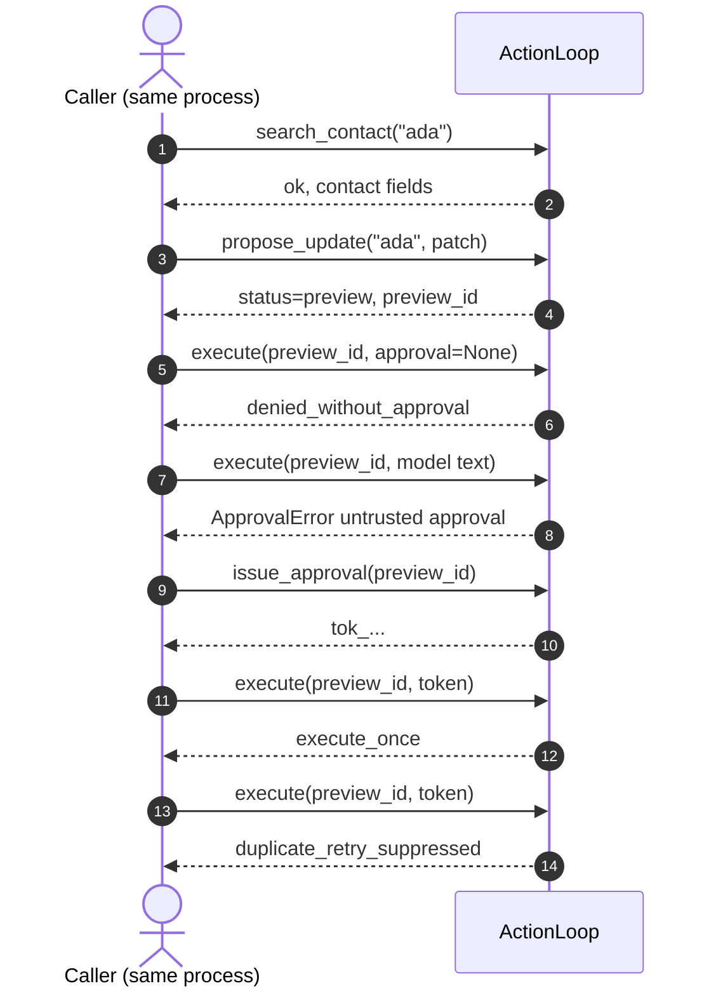
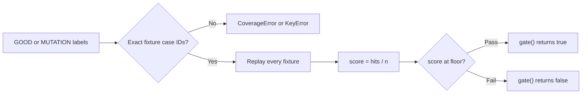

# llm-reviewer-path: eval gates, approval-bound writes, idempotent retries

llm-reviewer-path is a small offline Python sample of three controls around an LLM agent's write path (an eval gate that fails closed, writes that need an issued approval token, and retries that apply a write once), with no live model in the loop and no API key needed.

[](https://github.com/ChunkyTortoise/llm-reviewer-path/actions/workflows/ci.yml)
[](pyproject.toml)
[](LICENSE)

## Results

Every row was rerun offline on 2026-11-17 at commit `9fa2688` or later. No row uses a language model: the classifier and the injection detector are deterministic string checks.

| Metric | Value | n | Dataset | Model | Baseline | Reproduce |
|---|---|---|---|---|---|---|
| Eval gate score, correct label set (floor [`THRESHOLD`](receipts/eval_gate/gate.py#L6) = 1.00) | **1.00, pass** | 5 cases | [`cases.py#L11-L29`](receipts/retrieval_failure_modes/cases.py#L11-L29) (empty retrieval, conflicting evidence, prompt injection, malformed JSON, clean) | none, mock `classify()` | Mutated label set (injection marked clean): 0.80, fail | `uv run python -m receipts` |
| Writes applied when an approved write is retried with the same token | **1** (retry returns `duplicate_retry_suppressed`) | 2 `execute` calls | one in-memory contact | none | Call without a token: 0 writes (`denied_without_approval`) | `uv run pytest tests/test_hard_action.py` |
| Patch shapes that could change an approved write, now rejected before preview | **5 of 5** | 5 shapes | [`test_hard_action.py`](tests/test_hard_action.py): nested list, nested dict, non-str key, `str` subclass, stateful `Mapping` | none | Before `5ad8ec1`: nested list and dict values were shallow-copied and a post-approval change reached the write | `uv run pytest tests/test_hard_action.py` |
| Prompt-injection detector recall | **2 of 9** injections caught, 1 of 2 benign texts flagged | 11 texts | [`injection_corpus.json`](tests/fixtures/injection_corpus.json) | none, two-substring match | none (first measurement) | `uv run python -m receipts.retrieval_failure_modes.injection_corpus` |
| Offline test suite, run by CI on every push and pull request | **56 pass, 8 strict `xfail`** (the detector misses) | 64 tests | [`tests/`](tests/) | none | not applicable | `uv run pytest` |

The scope of each number is in [Methodology & limits](#methodology--limits).

## Quickstart

Needs Python 3.10+ and [uv](https://docs.astral.sh/uv/getting-started/installation/). No API key; network access only for the first dependency install. `uv run` installs the locked dev group on first use.

```bash
git clone https://github.com/ChunkyTortoise/llm-reviewer-path.git && cd llm-reviewer-path
uv run pytest
uv run python -m receipts
```

Without uv, a plain virtual environment works too (pytest is unpinned on this route):

```bash
python3 -m venv .venv && .venv/bin/python -m pip install pytest
.venv/bin/python -m pytest && .venv/bin/python -m receipts
```

`pytest` should report 56 passed and 8 xfailed. `python -m receipts` replays the eval scores and the approval sequence; its output must match the block below and in [docs/offline-receipt.md](docs/offline-receipt.md), and a test fails if it drifts.

<details>
<summary>Exact output of <code>uv run python -m receipts</code> (verified by <code>test_replay.py</code>)</summary>

```text
GOOD: score=1.00, n=5, gate=True
MUTATION: score=0.80, n=5, gate=False
read: {'ok': True, 'name': 'Ada', 'city': 'NY'}
propose: preview {'city': 'LA'}
without token: denied_without_approval
model text: ApprovalError untrusted approval
approved: execute_once
retry: duplicate_retry_suppressed
read after: {'ok': True, 'name': 'Ada', 'city': 'LA'}
```

</details>

<p align="center">
  
</p>
<p align="center"><sub>Terminal capture recorded 2026-11-17 with <a href="docs/demo.tape">docs/demo.tape</a> (<a href="docs/offline-receipt.md#visual-asset-provenance">provenance</a>).</sub></p>

<p align="center">
  
</p>
<p align="center"><sub>Editorial summary of the replay output above, hand-drawn, not a capture. Provenance: <a href="docs/offline-receipt.md">docs/offline-receipt.md</a>.</sub></p>

Then read the code in this order:

1. **Eval gate:** [`receipts/eval_gate/gate.py`](receipts/eval_gate/gate.py). `GOOD` passes, `MUTATION` fails, incomplete labels raise `CoverageError`, unknown IDs raise `KeyError`.
2. **Approval-bound write:** [`receipts/hard_action/loop.py`](receipts/hard_action/loop.py). Denied without a token, `ApprovalError` on model text, `execute_once`, then `duplicate_retry_suppressed`.
3. **Failure-mode fixtures:** [`receipts/retrieval_failure_modes/cases.py`](receipts/retrieval_failure_modes/cases.py) and the mock classifier in [`retriever.py`](receipts/retrieval_failure_modes/retriever.py).

## How it works



- **Reads are open, writes are previews.** `search_contact` needs no token. `propose_update` validates the target contact and returns a preview and a `preview_id`; a preview is not an execution ([`loop.py`](receipts/hard_action/loop.py)).
- **Only an issued token executes.** `execute` without a token returns `denied_without_approval`. Model-written approval text raises `ApprovalError`. Tokens are compared as UTF-8 bytes with `secrets.compare_digest`, so non-ASCII text also raises `ApprovalError`.
- **Approval is bound to what was approved.** The token is bound to a snapshot of the target query and patch. A patch must be a plain `dict` of plain `str` keys and values (anything else raises `TypeError`), and it is copied once, so neither the caller's dict nor the returned preview shares an object with the stored proposal. If the stored proposal changes after approval, `execute` raises `ApprovalError` before any write.
- **Retries are idempotent.** A used token cannot run the write again: a second `execute` returns `duplicate_retry_suppressed` and does not reapply the patch, even if the row changed in between. Re-approving an already-executed preview raises `ApprovalError`. Each read, proposal, approval and `execute` outcome, including a rejected approval (`denied_untrusted_approval`), is appended to an audit list; inputs rejected with `KeyError` or `TypeError` before a preview exists are not.
- **The eval gate fails closed.** `evaluate()` scores a candidate's labels against a mock `classify()` over the fixed fixtures ([`gate.py`](receipts/eval_gate/gate.py)). `gate()` requires the exact case IDs, the full count, and a numeric score at the floor, including for externally constructed reports.

## How it's evaluated



| Signal | What runs | Command |
|---|---|---|
| **Eval gate** | `GOOD` must pass and `MUTATION` must fail; the mutation is asserted, so a gate that stopped catching it would turn CI red | `uv run pytest tests/test_eval_gate.py` |
| **Fail-closed coverage** | Every single omission, empty or partial label sets, unknown IDs, and malformed external reports are rejected before or at the gate | `uv run pytest tests/test_missing_fixture_fails_closed.py` |
| **Approval boundary** | Denial, model-text rejection, copied patches, changed-proposal rejection, one execution, duplicate suppression, re-approval rejection | `uv run pytest tests/test_hard_action.py` |
| **Failure-mode fixtures** | Mock `classify()` on each fixture (including JSON-object parsing), no network | `uv run pytest tests/test_retrieval_failure_modes.py` |
| **Injection corpus** | Real detector on 11 labeled texts; the 8 known gaps are strict `xfail`, and the README table below must equal the generated report | `uv run pytest tests/test_injection_corpus.py` |
| **Replay & README invariants** | Replay must equal both documented blocks without tokens. Markdown and HTML link targets, heading anchors and line bounds are checked. Mermaid receives structural smoke checks, not syntax validation. | `uv run pytest tests/test_replay.py` |

CI ([`.github/workflows/ci.yml`](.github/workflows/ci.yml)) installs locked development dependencies, then runs strict mypy, Ruff and pytest on every push and pull request. Per-module commands are in [docs/verification-commands.md](docs/verification-commands.md).

### Injection detector corpus

The prompt-injection check in [`retriever.py`](receipts/retrieval_failure_modes/retriever.py) is a two-substring match. [`injection_corpus.json`](tests/fixtures/injection_corpus.json) holds 11 labeled texts, with labels set by what the text is, not by what the detector does. [`test_injection_corpus.py`](tests/test_injection_corpus.py) runs each one through the real detector; known misses are strict `xfail`, so CI stays green, the gap is recorded, and a detector fix fails the build until the case is un-marked. The table below is the output of `uv run python -m receipts.retrieval_failure_modes.injection_corpus`.

| Case | Technique | Label | Detector |
|---|---|---|---|
| `direct-prior` | direct phrase (existing substring) | injection | caught |
| `direct-previous` | direct phrase, mid-sentence | injection | caught |
| `case-whitespace` | case and whitespace variant | injection | missed |
| `paraphrase` | paraphrase | injection | missed |
| `role-spoof` | system-tag and role spoofing | injection | missed |
| `html-comment` | instruction hidden in an HTML comment | injection | missed |
| `base64` | base64 obfuscation | injection | missed |
| `zero-width` | zero-width character obfuscation | injection | missed |
| `non-english` | non-English phrasing (Spanish) | injection | missed |
| `benign-security-note` | benign: security note quoting an attack phrase | benign | false positive |
| `benign-eval-mention` | benign: mentions injection testing | benign | correct (not flagged) |

Caught 2 of 9 injections, 1 false positive.

## Decisions, failures, limits

### Decisions

- **Assert the mutation instead of shipping a red build.** The gate demo keeps CI green by testing that `gate()` rejects `MUTATION`, so a regression in the gate itself is what fails CI ([`test_eval_gate.py`](tests/test_eval_gate.py)).
- **Fail closed on coverage.** A candidate that skips a fixture raises `CoverageError` and an unknown ID raises `KeyError` before scoring, so a partial run can never clear the floor ([`test_missing_fixture_fails_closed.py`](tests/test_missing_fixture_fails_closed.py)).
- **Model text is never an approval.** Approval is a token minted by `issue_approval` and compared in constant time, not a string the model can write ([`loop.py`](receipts/hard_action/loop.py)).
- **Bind the token to a snapshot.** Approving a preview approves that query and patch only; any later change is rejected before the write.
- **Reject odd patch types instead of deep-copying them.** `copy.deepcopy` would also close the nested-value hole, but a `str` subclass with a false `__repr__` or a `Mapping` that answers differently per read would still show the approver one value and store another. Accepting only a plain `dict` of plain `str` closes all of these with one type check ([`loop.py`](receipts/hard_action/loop.py)).
- **Keep detector misses as strict `xfail`, not deleted cases.** The corpus records 7 missed injections and 1 false positive in CI; a detector fix turns the build red until the case is un-marked, so the table cannot silently go stale.

### Failures found

An adversarial pass on 2026-11-17 (probes using only the four public methods, no private state) found three gaps in the approval loop. All three are fixed in `5ad8ec1` and `9fa2688`, each with a regression test in [`test_hard_action.py`](tests/test_hard_action.py):

1. **Shallow copies let an approved write change.** `dict(patch)` copied only the top level, so a nested list or dict was the same object in the caller's patch, the preview, the stored proposal and the approved snapshot. The changed-proposal check compared that object with itself and the edited value was written. Four patch shapes bypassed approval this way (nested list, nested dict, `str` subclass, stateful `Mapping`).
2. **Rejected approvals left no audit entry.** A forged or wrong token raised `ApprovalError` without appending anything, so the README claim that every step is audited was false.
3. **Non-ASCII approval text raised `TypeError`.** `secrets.compare_digest` refuses non-ASCII `str`, so `"tok_é"` raised the wrong exception. It was still refused, but callers catching `ApprovalError` would miss it.

The injection detector is a known, unfixed failure: it catches 2 of 9 labeled injections (table above). It exists to show how gaps are recorded, not as a defense.

### Limits

- **No model.** Nothing here calls an LLM. `classify()` takes a case ID and matches literal strings, so the eval gate scores label sets against a deterministic mock; the labels are what is under test, not a model.
- **Single process.** Any caller in the same process can call `issue_approval`, so the approval boundary assumes the approver is a separate, trusted path. Tokens are random strings, not signatures, and do not expire. State is an in-memory dict; there is no durable storage or concurrency control.
- **No field allowlist on patches.** An approved patch can add any `str` key, for example `is_admin`. Approval binds the exact patch, so the approver sees the key, but nothing restricts which keys exist.
- **One interpreter in CI.** CI runs on whatever Python `uv` selects on `ubuntu-latest`; 3.10 is the declared floor (mypy and Ruff target it) but no 3.10 job runs.

Full scope notes are in [Methodology & limits](#methodology--limits).

### Where the patterns come from

| Pattern | Source |
|---|---|
| Offline replay as a CI check | DocExtract [offline replay](https://github.com/ChunkyTortoise/docextract/blob/main/scripts/eval_offline_replay.py), [gate](https://github.com/ChunkyTortoise/docextract/blob/main/scripts/eval_gate.py), [gate proof](https://github.com/ChunkyTortoise/docextract/blob/main/docs/eval-gate-proof.md), [workflow](https://github.com/ChunkyTortoise/docextract/blob/main/.github/workflows/eval-gate.yml), [PR #32](https://github.com/ChunkyTortoise/docextract/pull/32) |
| Indirect prompt injection in untrusted document text | DocExtract [ADR-0020](https://github.com/ChunkyTortoise/docextract/blob/main/docs/adr/0020-indirect-prompt-injection-defense.md), [failure analysis](https://github.com/ChunkyTortoise/docextract/blob/main/docs/eval-failure-analysis.md), [injection guard](https://github.com/ChunkyTortoise/docextract/blob/main/app/services/injection_guard.py) |
| Approval token on writes | Local to this repo ([`loop.py`](receipts/hard_action/loop.py)); no DocExtract parent |
| Field-engineering scoping (problem, constraints, first slice, exclusions, kill-check, handoff) | Redacted note: [`receipts/fde_scope/ACUITY.md`](receipts/fde_scope/ACUITY.md) |

## Methodology & limits

<details>
<summary>What each number covers, what is local to this repo, and what is not implemented</summary>

**Scope**
- Scope: a compact, offline code sample; the full systems are linked in [Decisions, failures, limits](#decisions-failures-limits). Retrieval is mocked, so there is no RAG pipeline here. [DocExtract](https://github.com/ChunkyTortoise/docextract) is the production system for the eval and retrieval patterns above; this repo does not claim unlisted production behavior, client details, metrics or features, and no DocExtract number is a result reproduced here.
- The local eval gate is a boolean over fixed fixtures. It is not branch protection on DocExtract, and it is a different demonstration from DocExtract's recorded failing regression run (PR #32, closed unmerged; see Provenance dates below).
- What is copied from the parent vs. added here: the parent contributes offline replay as a CI check, a recorded failing regression run, and the indirect prompt-injection threat model. Added here: the floor with exact fixture coverage, the asserted mutation, the local mock classifier and its fixtures, and the whole approval-token boundary.

**Eval gate and fixtures**
- The classification cases are fixed local fixtures and `classify()` is a deterministic mock using string checks and stdlib JSON object validation. The mutation changes the expected injection label. This is not a model-quality benchmark or a live RAG run.
- The local `retriever.py` is a mock, not DocExtract's injection guard.
- Supplying a complete report to `gate()` does not prove an external evaluation was honest; the gate checks only the case IDs, count and score it is given.

**Approval boundary**
- Single-process teaching example, not a production or distributed authorization service. The contact and execution history live in an in-memory dict.
- Tokens are random values, not digital signatures. `issue_approval` is callable by any caller in the same Python process; there is no separately authenticated approver, and callers must supply that trust boundary.
- Durable storage, concurrent execution and token expiry are not implemented.
- The changed-proposal rejection is checked by an internal-state test in `tests/test_hard_action.py` that edits private state (`_previews`) after approval. The replay does not run it, and it is a separate scenario, not something that happens after the successful execution in the replay.

**Hero figure**
- `docs/assets/reviewer-receipt.svg` is a hand-authored editorial diagram summarizing actual replay output, plus one panel labeled `Internal-state test` that comes from pytest only. It is not a terminal capture or a product screenshot. `docs/assets/terminal-demo.gif` is a real terminal capture of the quickstart commands, recorded with [`docs/demo.tape`](docs/demo.tape). `docs/assets/social-preview.svg` is an editorial social card and `social-preview.png` is its rasterization ([provenance](docs/offline-receipt.md#visual-asset-provenance)).
- The replay prints scores and the approval sequence without tokens or random preview IDs, so its output is stable; runtime varies.

**Environment**
- The commands match `pyproject.toml` (`requires-python`, dev group with pytest, mypy and Ruff, `addopts = "-q"`, which hides the platform banner) and CI. `uv.lock` pins development tools; the pip route installs the latest pytest and runs tests only. There is no Makefile.
- The three Quickstart commands were run on 2026-11-17 in a fresh `git clone` of this branch under `/tmp` with uv 0.11.29 on macOS: `uv run` installed 10 packages, then printed `56 passed, 8 xfailed` and the replay block above. Linux runs in CI only.
- The recorded 2026-10-01 verification in [docs/offline-receipt.md](docs/offline-receipt.md) reused an existing environment rather than a fresh `uv sync`; CI exercises the fresh-environment route.

**Field-engineering scope note**
- [`ACUITY.md`](receipts/fde_scope/ACUITY.md) is redacted markdown only and is not collected by pytest. Its source repo, `ChunkyTortoise/jorge_real_estate_bots`, is not public (HTTP 404), and `METRICS-SOT.md` is not in this repo.
- Its lead-volume figure is client-reported. Its test and workflow counts are historical figures copied from a non-public source. None of them is measured or reproduced here, which is why none appears in [Results](#results).

**Provenance dates**
- Rechecked on 2026-10-15. DocExtract PR #32 was closed without merge on 2026-10-02 at 6:48 PM PT (`2026-10-03T01:48:24Z`). DocExtract's README says that since 2026-10-03, branch protection on `main` has required the CI `test` check. The same README says the weighted replay is not a universal required merge check, and it records an earlier 2026-09-19 audit that found the default branch unprotected. This repo did not change DocExtract's branch protection. All parent links in [Decisions, failures, limits](#decisions-failures-limits) were re-verified HTTP 200 on 2026-10-15.

</details>

## Roadmap

Next steps, from the documented gaps in the approval example:

- A separately authenticated approver, so the process that proposes a write cannot also approve it.
- Token expiry.
- Durable storage for contacts, approvals and execution history.
- Safe concurrent execution of the same approved write.

## License

MIT
